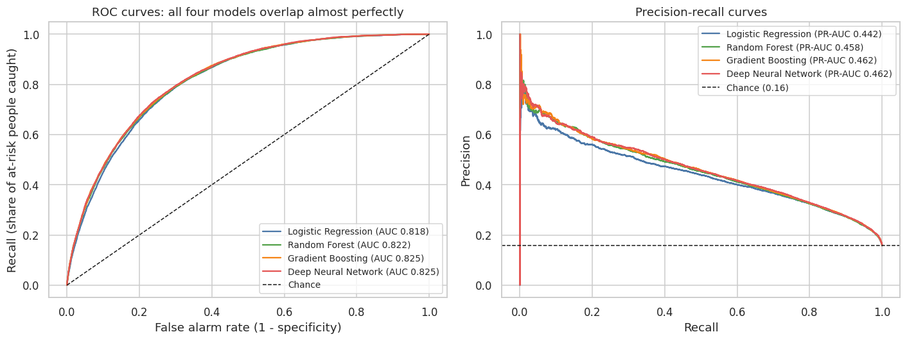
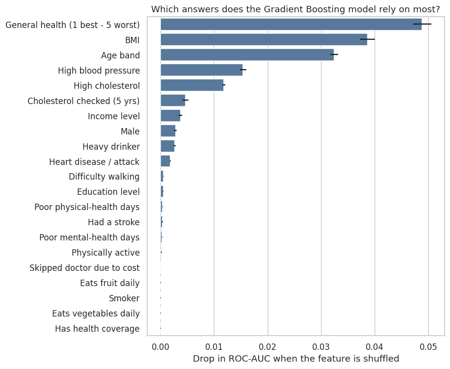
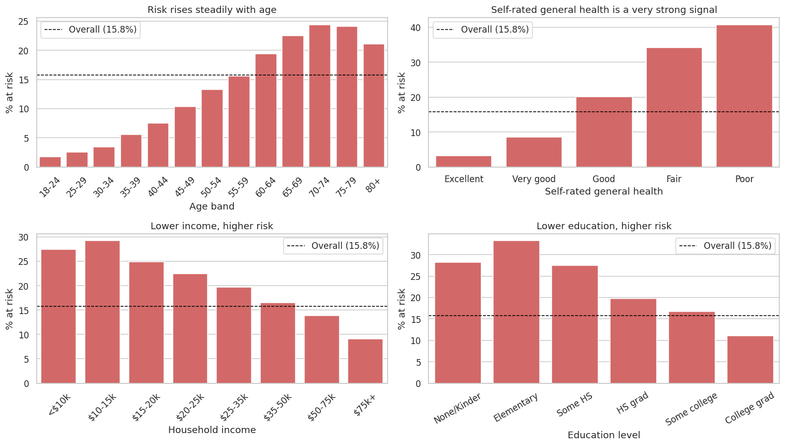
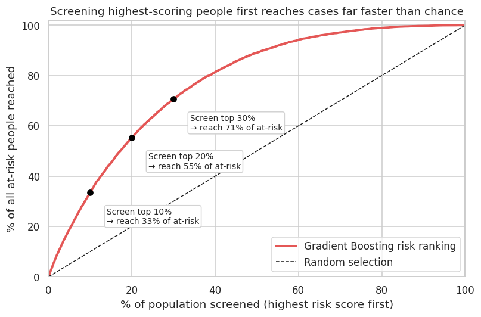
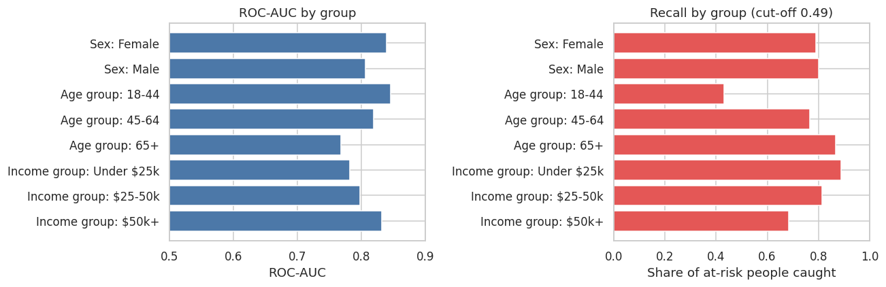
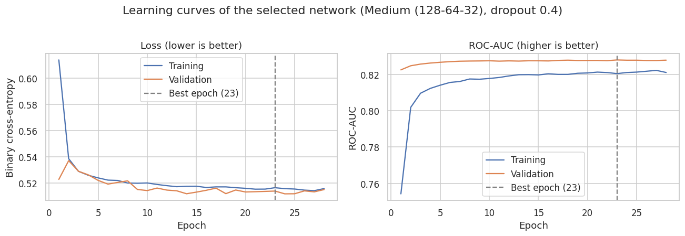

# Predicting Diabetes Risk from Everyday Health Survey Data

**Tayfun YUGRUK** | Machine Learning Capstone

---

## Executive summary

**The question:** Can a computer model that uses a few simple health and lifestyle questions (no blood tests) accurately identify people at risk of diabetes or prediabetes, and which answers matter most? In particular, does a *deep neural network* (a complex, modern type of AI model) do this better than simpler methods?

**The short answer**

- **Yes, a model can do useful screening work from survey answers alone.** It ranks people by risk correctly about **82% of the time** (technically a "ROC-AUC" of 0.82; 50% would be a coin flip, 100% perfect).
- **A deep neural network does not do meaningfully better than much simpler models.** Four models were tested on the same 50,736 people they had never seen. The neural network and a "gradient boosting" model **tied** at 0.825; the two simpler models scored 0.818 and 0.822. The limit is the information in the survey answers, not the sophistication of the model.
- **Three answers do most of the work:** how people rate their **general health**, their **BMI**, and their **age**, followed by **high blood pressure** and **high cholesterol**.
- **It works best as a tool to decide who to invite for a blood test first**, not to diagnose anyone. At a setting that catches about **80% of at-risk people**, it flags about 38% of the population, meaning roughly **3 people tested to find 1 at-risk person** (about 6 if people were picked at random).
- **Important warning:** with one cut-off for everyone, the tool finds far fewer at-risk **younger adults** (43% of those aged 18-44) than older adults (87% of those 65+). A real program would need group-specific settings.


*The four models' curves almost completely overlap, so the simpler models are nearly as good as the neural network.*

### Results at a glance

Scores on 50,736 people held back from training (7,995 of whom are at risk). "Recall" = share of at-risk people the model catches. "Precision" = share of flagged people who really are at risk. Recall and precision are at a standard 0.5 cut-off.

| Model | Overall ranking score (ROC-AUC) | Recall | Precision |
|---|---|---|---|
| Always say "not at risk" (do-nothing baseline) | 0.500 | 0% | n/a |
| Logistic regression (simple, easy to explain) | 0.818 | 76% | 34% |
| Random forest | 0.822 | 75% | 35% |
| Gradient boosting | 0.825 | 78% | 34% |
| **Deep neural network** | **0.825** | **79%** | **33%** |

> **Why not just report accuracy?** Only about 1 in 6 people in the data is at risk, so a "model" that says *nobody* is at risk is 84% accurate yet finds no one. Accuracy is therefore misleading here, and we judge the models by how well they rank people and how many at-risk people they catch.

---

## Why this question matters (in plain language)

According to the CDC's National Diabetes Statistics Report, about **38.4 million Americans have diabetes, and 8.7 million of them do not know it. Another 97.6 million adults have prediabetes**, the stage at which lifestyle changes can still prevent or delay the disease ([CDC](https://www.cdc.gov/diabetes/data/statistics-report/index.html)). Blood tests are the reliable way to find it, but testing everyone is expensive and many people never get tested.

**If this question goes unanswered,** clinics, employers, insurers and public-health programs keep relying on broad, untargeted outreach: money and effort go to people unlikely to benefit, and many at-risk people are never reached until the disease is advanced and treatment is costly.

**What this analysis adds:** it shows that a handful of simple questions can help **prioritize who to offer a blood test first**, shows *which factors* are worth acting on, and, just as importantly, shows **what not to spend on**: a complicated AI system is not needed to get this benefit. It also flags a fairness gap that should be fixed before any real-world use.

---

## What drives risk?



- **General health (self-rated), BMI and age** are by far the most influential answers: worse health, higher BMI and older age all raise predicted risk.
- **High blood pressure** and **high cholesterol** come next.
- Many other things people associate with diabetes (smoking, diet, difficulty walking, past stroke) look strongly linked on their own, but add little *extra* once the factors above are known, because they overlap with them.
- Two results need care: **"had a cholesterol check"** appears as a risk marker and **heavy drinking** appears protective. These are almost certainly reporting and detection effects (people who see doctors get diagnosed; people diagnosed are told to cut back on alcohol), **not** real causes.


*Risk climbs with age (leveling off after about 70) and as self-rated health worsens (about 3% for "Excellent" vs. about 40% for "Poor"), and falls as income and education rise.*

---

## How would this be used? A screening example

The model gives each person a risk score. A program chooses a cut-off: everyone above it is invited for a blood test.

| If the program aims to catch... | % of the population invited | People tested per at-risk person found |
|---|---|---|
| ~70% of at-risk people | 29% | 2.7 |
| **~80% of at-risk people** | **38%** | **3.0** |
| ~90% of at-risk people | 51% | 3.6 |


*Screening the top 10% of scores reaches 33% of at-risk people; the top 20% reaches 55%; the top 30% reaches 71%.*

---

## Recommendations

1. **Use the model to prioritize blood-test invitations, not to diagnose.** Only a lab test confirms diabetes.
2. **Choose the cut-off to match your capacity.** A larger screening budget supports a lower cut-off (more cases found, more tests per case).
3. **Set group-specific targets, especially by age**, and track results by group (see below).
4. **Focus prevention on the modifiable drivers** that overlap with the model's top factors: blood pressure, cholesterol and weight management.
5. **Prefer the simplest adequate model.** Gradient boosting (to score people) and logistic regression (to explain results) match the neural network's performance with far less complexity.

### Fairness: one cut-off does not work equally well for everyone



At a single cut-off, the model catches **87% of at-risk people aged 65+ but only 43% of those aged 18-44**, and **89% of at-risk people earning under $25k but only 68% of those earning $50k+**. The model's score partly reflects how common diabetes is in a group, so at-risk younger and higher-income people tend to score lower and slip under the cut-off. A real program should consider age-specific cut-offs and monitor outcomes by group.

---

## Limitations

- **Self-reported survey data (US adults, 2015) with no lab values.** Labels reflect *diagnosed* conditions, so undiagnosed cases are counted as "not at risk". This probably makes the measured precision (about 1 in 3) look worse than it is in reality.
- **Prediabetes was merged with diabetes.** It is only 1.8% of the data, too rare to model on its own.
- **Associations, not causes.** The model shows what predicts a diagnosis, not what would change it.
- **One data year, one train/test split, one training run per network.** Differences smaller than about 0.002 in the ranking score should not be over-interpreted.
- Not validated on any other population or year, so it must **not** be used for real decisions without further testing.

## Next steps

1. Test the model on newer survey years or a different population.
2. Add objective measurements (fasting glucose, HbA1c, waist size), which would likely raise the ceiling far more than any model change.
3. Build and evaluate age/income-aware cut-offs.
4. Model prediabetes separately if more data becomes available.
5. Convert scores into calibrated probabilities and pick the cut-off using explicit costs (cost of a test vs. cost of a missed case).

---

# Technical details

## Research question
Can a deep neural network, using basic health and lifestyle survey responses, accurately identify people at risk of diabetes or prediabetes, and which factors drive that risk the most?

## Data source
CDC **Behavioral Risk Factor Surveillance System (BRFSS) 2015**, as the *Diabetes Health Indicators Dataset* on Kaggle: <https://www.kaggle.com/datasets/alexteboul/diabetes-health-indicators-dataset>. File used: `diabetes_012_health_indicators_BRFSS2015.csv` (in `data/`).

- **253,680 respondents, 21 features** (blood pressure, cholesterol, BMI, smoking, stroke, heart disease, physical activity, diet, alcohol, healthcare access, general/mental/physical health, difficulty walking, sex, age band, education, income) and a 3-class target (0 = no diabetes, 1 = prediabetes, 2 = diabetes).
- No missing values. A full data dictionary is in Notebook 1.

## Cleaning and preparation (details in Notebook 1)
| Step | Decision and reason |
|---|---|
| Target | Prediabetes + diabetes merged into one binary **at-risk** label (15.8% of rows). The goal is screening, and prediabetes alone is only 1.8% of the data. |
| Duplicates | **Kept** (23,899 rows, 9.4%). They are almost all healthy people with very common answers, and identical answer profiles sometimes have different outcomes, so they are different people. Removing them would distort the sample. A sensitivity check (Notebook 2) shows conclusions are unchanged. |
| Outliers | BMI capped at 60 (805 respondents); no rows removed. |
| Encoding | None needed: binary and ordinal features are already numeric and show ordered trends. |
| Scaling | `StandardScaler` inside the model pipelines (fit on training data only) for logistic regression and the neural network. |
| Split | 80% training / 20% test, **stratified**, `random_state=42`. The test set was used only once per model, for the final evaluation. |
| Imbalance | Class weights (no synthetic oversampling). |

## Methodology (details in Notebooks 2 and 3)
**Evaluation metrics and rationale.** Models were tuned to maximize cross-validated **ROC-AUC**, because it judges ranking quality across all cut-offs and is not fooled by class imbalance. **PR-AUC, recall, precision and F1** are also reported: in screening, missing an at-risk person (recall) matters more than an extra test (precision).

| Model | Tuning | Best settings |
|---|---|---|
| Logistic regression | Grid search, 5-fold CV: L1 vs. L2 penalty, C | L2, C = 0.001 (all settings within 0.0006 AUC) |
| Random forest | Grid search, 5-fold CV: tree depth, min leaf size | depth 16, min leaf 20 |
| Gradient boosting | Grid search, 5-fold CV: learning rate, depth, rounds | learning rate 0.05, depth 3, 400 rounds |
| Deep neural network (Keras) | 6 designs (3 sizes x 2 dropout rates) on a validation slice; Adam optimizer, class weights, batch norm, dropout, early stopping | 128-64-32 units, dropout 0.4 (14,081 parameters) |

**Key technical results**

- **Cross-validated ROC-AUC (training data):** logistic regression 0.819, random forest 0.823, gradient boosting 0.825. Logistic regression shows no overfitting (train/CV gap 0.0002); the random forest shows mild overfitting (gap 0.035).
- **Neural network vs. the others (paired bootstrap, 200 resamples):** +0.0005 vs. gradient boosting (95% CI -0.0004 to +0.0014, a tie); +0.0030 vs. random forest; +0.0067 vs. logistic regression. The latter two are real but practically tiny.
- **No overfitting in the network:** training and validation curves track each other closely; network size made less than 0.001 difference in validation ROC-AUC.
- **Sensitivity to duplicates:** removing them lowers all scores by about 0.015 but leaves the ranking of the models unchanged.



## Project structure
```
.
├── README.md                                   <- this file (non-technical summary + technical details)
├── requirements.txt
├── data/
│   └── diabetes_012_health_indicators_BRFSS2015.csv
├── notebooks/
│   ├── 01_EDA_and_Data_Preparation.ipynb       <- data quality, cleaning, EDA, statistical tests, split
│   ├── 02_Baseline_and_Ensemble_Models.ipynb   <- logistic regression, random forest, gradient boosting (grid search + CV)
│   └── 03_Deep_Neural_Network_and_Final_Evaluation.ipynb  <- DNN, model comparison, screening policy, drivers, fairness, conclusions
├── images/                                     <- figures used in this README
└── results/                                    <- outputs passed between notebooks (test-set predictions, best settings, saved network)
```

## How to reproduce
1. `pip install -r requirements.txt`
2. Run the notebooks **in order** (1, 2, 3) from the `notebooks/` folder. Notebook 2 saves results that Notebook 3 reads.
3. Approximate run time on a single CPU core: Notebook 1 about 1 minute, Notebook 2 about 17 minutes (grid searches), Notebook 3 about 9 minutes.

All random seeds are fixed (`random_state=42`), so results should reproduce closely.

## Notebooks
- [Notebook 1: Data understanding, cleaning and EDA](notebooks/01_EDA_and_Data_Preparation.ipynb)
- [Notebook 2: Baseline and ensemble models](notebooks/02_Baseline_and_Ensemble_Models.ipynb)
- [Notebook 3: Deep neural network and final evaluation](notebooks/03_Deep_Neural_Network_and_Final_Evaluation.ipynb)

## Contact
**Tayfun YUGRUK** | tayfunyugruk[at]gmail.com | https://www.linkedin.com/in/tayfunyugruk
